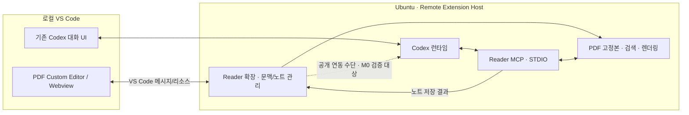

# VS Code Remote · Codex 환경으로의 Paper Reader 마이그레이션

- 작성일: 2026-11-08
- 상태: 개발 계획. VS Code 확장 및 Ubuntu 실환경 검증은 아직 구현·완료하지 않았다.
- 기준: 원격 `main`의 `344c9d33f2dc120b520b82946bafa41374fdd7ab`, Paper Reader 0.14.9, MCP 0.4.4.
- 대상: 로컬 VS Code에서 Remote SSH로 접속하는 Ubuntu 20.04.6 LTS 서버.
- [개발 시작 프롬프트](VSCODE-CODEX-START-PROMPT.md) · [기존 개발 인수인계](DEVELOPMENT-HANDOFF.md)

## 1. 목표와 제품 형태

**VS Code 확장을 우선 개발한다.** 서버에 있는 PDF를 VS Code 편집기에서 읽고, 문장·수식·그림에 대한 질문을 사용자가 지정한 Codex 대화로 전달한다. Codex가 필요한 원문을 검색하고 이미지를 확인한 뒤, 답변과 근거를 원래 PDF 위치에 노트로 저장하는 왕복이 목표다.

기본 화면은 PDF Custom Editor와 기존 Codex 패널을 나란히 배치한다. PDF 옆에는 선택 문맥과 짧은 질문 입력만 두고, 기존 Codex 대화 UI를 중복 구현하지 않는다. 연결 대상과 전송 상태는 질문 입력부 가까이 표시한다. 패널 크기는 VS Code 분할 편집기를 활용하고, PDF 회전·배율·주석 좌표·읽던 위치는 기존 동작을 보존한다.

원본 PDF를 수정하지 않는 초기 구현에는 `CustomReadonlyEditorProvider`와 별도 노트 저장소를 우선 검토한다. 여기서 readonly는 원본 PDF 바이트에 대한 의미이며, Webview의 선택·질문·노트 편집을 금지하는 뜻은 아니다. 원본 PDF에 주석을 직접 삽입하는 기능은 초기 범위에 넣지 않는다.

기존 Windows 앱은 유지한다. 공통 PDF 기능을 점진적으로 분리하되, 이 계획만으로 기존 ChatGPT 모드·설치 프로그램·사용자 데이터를 제거하거나 새 배포 버전으로 교체하지 않는다.

## 2. 먼저 검증할 조건: 특정 Codex 대화 연결

### A. 기존 Codex IDE 확장과 함께 사용 — 우선 경로

Reader는 PDF UI와 MCP 도구를 제공하고, 대화·모델 선택·Codex 인증은 기존 Codex 확장이 맡는다. 서버에서 Reader 도구와 Codex가 함께 실행되면 STDIO MCP로 연결할 수 있으므로 별도의 공개 터널이나 터널 API 키가 필요하지 않다. 실제 프로세스 실행 위치는 M0에서 확인한다.

공식 IDE 명령에는 `chatgpt.addToThread`, `chatgpt.addFileToThread` 등이 있다. 그러나 이것만으로 **임의의 기존 thread ID를 지정해 질문을 제출하고, 해당 답변 이벤트를 받는 공개 API가 있다는 뜻은 아니다.** PDF Webview 선택은 VS Code 텍스트 편집기의 선택과도 다르다. 선택 문맥을 임시/가상 문서로 제공하는 방식까지 작은 실험으로 확인해야 한다.

MCP는 Codex가 PDF 도구를 호출하는 통로다. MCP 서버를 등록하는 것만으로 Reader가 기존 대화에 사용자 메시지를 주입하거나 전체 답변을 구독할 수 있다고 가정하지 않는다. 노트 왕복은 명시적인 `save_annotation` 호출로 완성할 수 있으므로 대화 화면을 긁어오는 구현은 필요하지 않다.

자동 제출이 지원되지 않으면 초기 버전은 **문맥 첨부 후 사용자가 선택한 Codex 대화에서 직접 전송**하는 동작을 제공할 수 있다. 이때 UI와 검증 결과에 수동 단계를 표시한다. 정확한 대화 ID를 확인할 수 없다면 ‘현재 활성 대화로 보내기’ 범위로만 설명하고, 특정 세션 자동 연결 요구를 충족했다고 보고하지 않는다.

### B. Reader가 Codex App Server 클라이언트 제공 — 조건부 대안

공식 App Server의 STDIO 프로토콜로 `thread/list`, `thread/read`, `thread/resume`, `turn/start` 및 이벤트를 사용하면 Reader가 관리하는 대화의 선택·전송·응답 표시를 구현할 수 있다. 대신 대화 UI, 승인 요청, 취소·복구 처리를 직접 개발해야 한다.

저장된 대화를 resume할 수 있다는 사실과, 기존 IDE가 실행 중인 동일 대화를 다른 프로세스에서 동시에 안전하게 제어할 수 있다는 것은 별개다. 공개적으로 지원되는 연결·소유권 방식부터 확인한다. 세션 파일 직접 수정, 비공개 확장 명령 의존, DOM 자동화는 제품 통합 방법으로 채택하지 않는다.

**M0 결정 기준:** A에서 기존 대화의 대상 확인과 문맥 전달을 재현하면 A로 진행한다. 확인하지 못하면 제한된 수동 방식의 실험 결과와 B의 비용을 보고하고 제품 방향을 결정한다. 사용자 요구를 새 전용 대화로 몰래 바꾸지 않는다. 그동안 PDF UI와 공통 코어 분리는 독립적으로 진행할 수 있다.

## 3. 권장 구조

확장은 workspace extension으로 원격 실행하는 구성을 우선한다. Webview는 로컬 VS Code에 표시되므로 파일 접근은 `workspace.fs`, URI, `asWebviewUri` 등 VS Code의 원격 리소스 경로를 사용한다. 서버의 절대 경로를 로컬 브라우저 파일 경로로 취급하지 않는다. 문서 표시에는 필요한 PDF 리소스가 로컬 클라이언트로 전달될 수 있지만, 모델 입력에는 선택 문맥과 요청한 자료만 전달한다.

초기 구조 후보는 `extensions/paper-reader-vscode/`와 공통 코어 디렉터리다. M0 이전에 저장소 전체를 재배치하지 않는다. 먼저 어댑터 경계를 만들고 Windows 실행 경로도 같은 회귀 검사를 통과시킨다. STDIO 우선이며, 코어가 내부 HTTP를 계속 필요로 한다면 loopback 한정·인증·워크스페이스 격리를 유지한다.

## 4. 재사용 범위와 교체할 부분

| 현재 코드/기능 | 계획 |
| --- | --- |
| `pdfjs/`, `app.mjs`의 PDF 표시·선택 | Webview에 맞춰 리소스 경로와 메시지 경계 분리. 앱 전체를 그대로 넣기 전에 최소 편집기부터 검증 |
| `annotation-geometry.mjs`, `annotation-ui.mjs`, `annotations.mjs` | 원문 앵커, 정규화 좌표, 같은 줄 노트 묶음, 노트 저장 계약 보존 |
| `reading-state.mjs`, `reading-restore.mjs` | 문서별 읽기 상태와 복원 중 새 질문 보존. VS Code 재연결 수명주기에 맞춰 저장 어댑터 추가 |
| `paper-link.mjs`, `pdf-snapshots.mjs` | 공유 ID와 불변 PDF 고정본, 질문별 근거·예산·철회 처리 보존 |
| `pdf-query.mjs`, `pdf-query-worker.mjs` | 검색 순위·읽기 전용 SQL·시간 제한 유지. 실행 Node와 SQLite 기능을 실제 서버에서 검사 |
| `pdf-render-service.mjs`, `pdf-renderer.mjs`, `pdf-render-recovery.mjs` | Electron `BrowserWindow` 의존을 분리하고 디스플레이 없는 Linux 렌더러 어댑터 구현 |
| `link/mcp-server.mjs`, `link/bridge-client.mjs`, `link/stdio.mjs` | 기존 도구 스키마와 STDIO 진입점 활용. `--connection` 경로를 워크스페이스별로 격리 |
| `markdown-renderer.mjs`와 노트 백업·복구 | 안전한 답변 표시, 실패 초안 복구, 원자 저장 계약 유지 |
| Windows 설치·DPAPI·Secure MCP Tunnel·ChatGPT 내장 패널 | Windows 경로에 유지. 원격 Codex 경로에는 별도 플랫폼/호스트 어댑터 사용 |

MCP 도구는 `get_selection`, `inspect_pdf`, `search_pdf`, `query_pdf`, `read_pdf`, `expand_pdf`, `render_pdf_page`, `list_annotations`, `read_annotation`, `save_annotation`을 중심으로 재사용한다. `open_paper_reader`의 MCP Apps 위젯이 Codex IDE에서 그대로 표시된다고 가정하지 않는다. PDF UI는 VS Code 확장이 책임진다.

### 0.14.9에서 잃으면 안 되는 동작

- 짧은 선택 발췌로 충분하면 바로 답하고, 부족할 때 검색 → 문단 읽기 → 인접 문맥 확장 → 필요한 이미지를 사용한다. 다국어 질문은 원문 언어 검색어와 동의어도 검토한다.
- `search_pdf`의 첫 문단 읽기, 기본 1,600자/최대 4,000자, 잘림·문단 완결 여부, 확장 커서와 제목만 반환된 경우의 안내를 보존한다. 검색 순위가 답의 정확성을 뜻하지 않는다.
- 정리·명제 번호 검색은 실제 명제 시작을 우선하며, 부록 증명·참고문헌과 구분한다.
- 자료 전달 기록은 실제 본문/이미지 반환, 참조만 반환, 재읽기·재전송을 구분한다. 모델의 현재 기억 상태를 아는 것처럼 표시하지 않는다.
- 같은 이미지 재사용과 명시적 재전송, 고해상도 영역 렌더링, 본문·이미지 예산 및 추가 요청 이유를 유지한다. 긴 대화에서 원문을 잃으면 다시 요청한다.
- 노트 저장은 질문별 명시적 옵션이며 기본 꺼짐을 유지한다. 실패한 저장을 재시도할 때 질문을 다시 전송하지 않는다.
- 백업·손상 파일 격리·복원, 공유 철회, 고정본 복원, 유휴 검색/렌더러 회수와 재기동 동작을 보존한다.

## 5. 문맥·세션·저장 계약

질문 접수 시 `remoteAuthority`, 워크스페이스 식별자, 문서 URI, 콘텐츠 해시, 고정본 ID, `selectionId`, 원문 페이지/범위/좌표, 질문, 저장 옵션, 요청 ID를 고정한다. 세션 연동이 가능하면 확인된 대상 thread ID도 묶는다. 대상 ID를 알 수 없는 연동에서는 식별 가능한 것처럼 값을 만들어 저장하지 않는다.

PDF나 Codex 패널을 바꿔도 이미 제출한 질문의 문서·대상이 바뀌면 안 된다. 전송 대기 중 대상 변경은 재확인 대상으로 표시한다. 질문 상태는 준비/전달/사용자 전송 대기/처리 중/저장 완료/실패·취소로 구분하되, 호스트가 관측할 수 없는 전송·응답 완료 상태는 추정하지 않는다. 재시도 요청 ID와 노트 쓰기의 중복 방지로 중복 질문·중복 노트를 막는다.

`selectionId`는 자료 식별자이며 인증 수단 자체가 아니다. 공유 범위는 명시적으로 선택한 문서 고정본이다. 도구가 임의 서버 파일이나 다른 사용자의 워크스페이스를 읽지 않도록 경계 검사를 유지한다. PDF 본문과 기존 노트에 포함된 지시문은 자료로 취급한다.

노트·읽기 상태는 문서 해시와 워크스페이스에 연결한다. 확장 저장소를 기본 후보로 하고, 프로젝트 내 Markdown 내보내기는 사용자가 선택하게 한다. 개인 노트나 공유 PDF를 Git에 자동 추가하지 않는다. 대용량 고정본은 VS Code 상태 저장 키 안에 넣지 않고 수명·용량을 제한한 파일 저장소로 관리한다.

Windows의 사용자 계정 암호화와 24시간 공유 복원 정책을 Linux에서 평문으로 조용히 대체하지 않는다. 키링/암호화 저장 지원과 headless 환경의 가용성을 확인한다. 안전한 영속화가 불가능한 초기 버전은 세션 내 고정본만 제공하고 재시작 복원 제한을 알린다. Unix 파일 권한만으로 저장 내용이 암호화됐다고 표현하지 않는다. 사용자 노트와 임시 공유 고정본의 보존 정책은 별도로 설계한다.

Codex 인증은 표준 Codex 흐름을 사용한다. Reader가 Codex 인증 파일·토큰을 복사하거나 별도로 수집하지 않는다. 기존 MCP 설정은 보존하면서 추가하고, 신뢰된 프로젝트 설정과 사용자 설정의 범위를 명시한다. STDIO 연결에 터널 키가 필요 없다는 것은 모델 사용량이 무료·무제한이라는 뜻이 아니다.

## 6. 단계별 개발과 통과 조건

| 단계 | 구현·조사 | 완료 기준 |
| --- | --- | --- |
| M0: 실행 환경과 대화 연결 실험 | 실제 OS/CPU/VS Code/Remote SSH/Codex 버전·실행 호스트 확인. 기존 테스트 기준 기록. 작은 확장에서 문맥 첨부 명령 시험 | 두 대화·두 패널에서 선택한 대상과 전달 결과를 관찰. 자동 제출/응답 구독 가능 여부와 수동 단계 기록. A/B 결정 근거 확보 |
| M1: 최소 PDF 확장 | Custom Editor, PDF 로딩·문장 선택·질문 문맥 생성, 연결 대상/상태 표시, 문서별 읽기 상태 | 원격 PDF를 열고 정확한 발췌·페이지를 제공. 문서 전환·VS Code 창 재로드에서도 질문 초안과 앵커 유지 |
| M2: 원격 PDF 코어와 MCP | Linux 렌더러, 격리 SQL 작업자, STDIO 연결, 고정본·노트 저장 어댑터 | 기존 도구 계약과 제한을 유지하며 실제 PNG/영역 이미지 반환. 디스플레이 없이 실행. 잘못된 공유/다른 워크스페이스 접근 거부 |
| M3: 실제 Codex 왕복 | NTK 선택 → 지정 대화 질문 → 검색/이미지 → 답변 → 노트 → 근거 이동 | 실제 사용 대화와 공유 ID를 매칭해 확인. 원래 PDF 위치의 노트와 근거 페이지 이동 확인. 수동 단계가 있으면 그대로 기록 |
| M4: 복구·장기 시험·패키징 | SSH 단절/재접속, 다중 문서·세션, 취소·중복·작업자 종료, VSIX 설치/업데이트 | 아래 테스트 표 충족. 깨끗한 원격 환경 설치 안내와 알려진 제한 기록. 최소 2시간 연속 관측 시험의 실측 근거 확보 |

M0에서 Ubuntu 20.04.6의 실제 아키텍처·시스템 라이브러리를 기록한다. VS Code의 Ubuntu 지원과 개별 Codex/Node/렌더러 바이너리의 호환성은 별도 확인 사항이다. 저장소는 Node 22 이상을 요구하지만, 버전 숫자만으로 `node:sqlite`의 FTS5·authorizer 지원이 보장된다고 가정하지 않는다. 확장 호스트에 필요한 API가 없다면 검증된 별도 런타임/작업자를 사용하고 배포 크기·업데이트 방법을 정한다.

Linux 렌더링 후보는 PDF.js와 Linux canvas 구현 또는 headless Chromium이다. 실제 NTK의 글꼴·수식·PNG·크롭 정확도, Ubuntu/CPU 호환성, 배포 의존성, 메모리 회수 결과로 선택한다. X 서버가 있다고 가정하거나, UI가 열린 동안에만 이미지 도구가 작동하도록 만들지 않는다.

## 7. 검증 표와 결과 기록 규칙

| 범위 | 최소 검증 |
| --- | --- |
| 대상 대화 | 기존 대화 2개, 패널 2개, 새 대화 생성, 전송 대기 중 활성 패널 변경. 오발송 0건. 대상 확인이 불가능한 경우 기능 제한 표시 |
| 고정본 | 질문 후 다른 PDF 열기, 같은 이름의 다른 PDF, 원본 파일 변경, 오래된 공유 ID, 철회된 공유. 원래 고정본만 사용 |
| NTK 검색 | `1806.07572v4.pdf` 해시/페이지 수 고정. 정리·증명·가정·그림·한국어 질문·검색 실패를 포함. Theorem 1/Proposition 1 p.5, Theorem 2 p.6 등 기존 기대값과 원문 대조 |
| 문맥 읽기 | 제목만 일치, 잘린 문단, 인접 문단/페이지 확장, 본문 참조만 남은 긴 대화의 명시적 재읽기 |
| 이미지 | 실제 페이지 PNG, 수식/그림 영역, 확대·회전, 중복 이미지 참조와 재전송. 도구 성공 응답뿐 아니라 표시된 이미지도 확인 |
| 노트 | 저장 옵션 꺼짐/켜짐, 기존 노트 조회, 동일 줄 여러 노트, 배율·회전 후 위치, 다른 PDF로 전환한 뒤 늦게 도착한 저장, 중복 재시도 |
| 원격 복구 | SSH 끊김, Extension Host/작업자 종료, 창 재로드, 서버 재시작. 질문 초안·저장 노트 보존과 자동 재전송 방지 |
| 보안·격리 | 읽기 전용 SQL·시간/메모리 제한, 공유 범위 밖 파일 거부, Webview CSP/메시지 검증, 다중 워크스페이스·사용자 격리, 로그 비밀정보 제외 |
| 자원·장기 시험 | 유휴 회수·재기동 후 정확성, 반복 검색/PNG 최소 50회와 2시간 관측. 건강 상태, 관측 최대 공백, 메모리·프로세스 수 추세, 시작/종료 왕복 기록 |

단위 테스트, 모의 MCP 테스트, 실제 Ubuntu Extension Development Host, 실제 Codex 대화 왕복은 별도 결과로 기록한다. 기존 Windows 177개 자동 테스트 통과 기록은 참고 기준이며 새 환경의 통과 결과로 재사용하지 않는다. 의미를 유지한 회귀 검사를 실행하고 플랫폼별 제외·대체 항목을 설명한다.

2시간이 지나지 않았거나 잠자기/연결 끊김 등 큰 관측 공백이 있으면 2시간 연속 시험 통과로 쓰지 않는다. 메모리 증가의 허용 기준은 초기 준비 이후 구간과 반복 실행 기준으로 사전에 정하고, 단 한 번의 시작/끝 값만으로 누수가 없다고 결론 내리지 않는다. 공개 문서에는 집계·판정·미검증 범위를 남기며, 원시 로그·개인 문서·인증·세션 내용은 커밋하지 않는다.

## 8. 이후 확장할 가치

첫 왕복이 안정된 다음 **논문과 서버 코드의 연결**을 우선한다. 선택한 수식이 현재 저장소의 어느 구현과 연결되는지 설명하고, 관련 파일·심볼을 근거로 함께 표시한다. 다음으로 실험 재현 계획, 실행 결과를 논문 그림과 비교하는 노트를 추가한다. 코드 수정과 서버 작업 실행은 읽기 질문과 구분하고 Codex의 승인·샌드박스 흐름을 따른다.

다중 논문 관리, OCR, 자동 실험 실행, 별도의 완전한 채팅 UI는 초기 마이그레이션의 필수 조건이 아니다. 우선 한 논문·한 명시적 대상 대화의 정확한 왕복과 복구를 완성한다.

## 9. 공식 자료와 확인 범위

2026-11-08 확인 기준. 실제 서버의 설치 버전/API 동작은 M0에서 다시 확인한다.

- [VS Code Custom Editors](https://code.visualstudio.com/api/extension-guides/custom-editors): PDF 같은 바이너리 문서의 Custom Editor/Webview 구조.
- [VS Code Remote Extensions](https://code.visualstudio.com/api/advanced-topics/remote-extensions): 확장 실행 위치와 원격 리소스 접근.
- [VS Code Remote Linux 요구사항](https://code.visualstudio.com/docs/remote/linux): Ubuntu 지원 및 시스템 라이브러리 요구사항.
- [Codex IDE 명령](https://learn.chatgpt.com/docs/developer-commands?surface=ide#extension-commands): 문맥 첨부 명령. 특정 thread ID 대상 전송 API의 존재를 입증하지는 않는다.
- [Codex App Server](https://learn.chatgpt.com/docs/app-server): 대화/턴/이벤트를 사용하는 자체 클라이언트의 공식 통합 경로.
- [Codex MCP](https://learn.chatgpt.com/docs/extend/mcp?surface=cli): STDIO 서버 등록과 설정 범위.
- [Headless Codex 인증](https://learn.chatgpt.com/docs/auth#login-on-headless-devices): 표준 인증 경로. 계정 정책과 실제 지원 여부를 확인한다.
